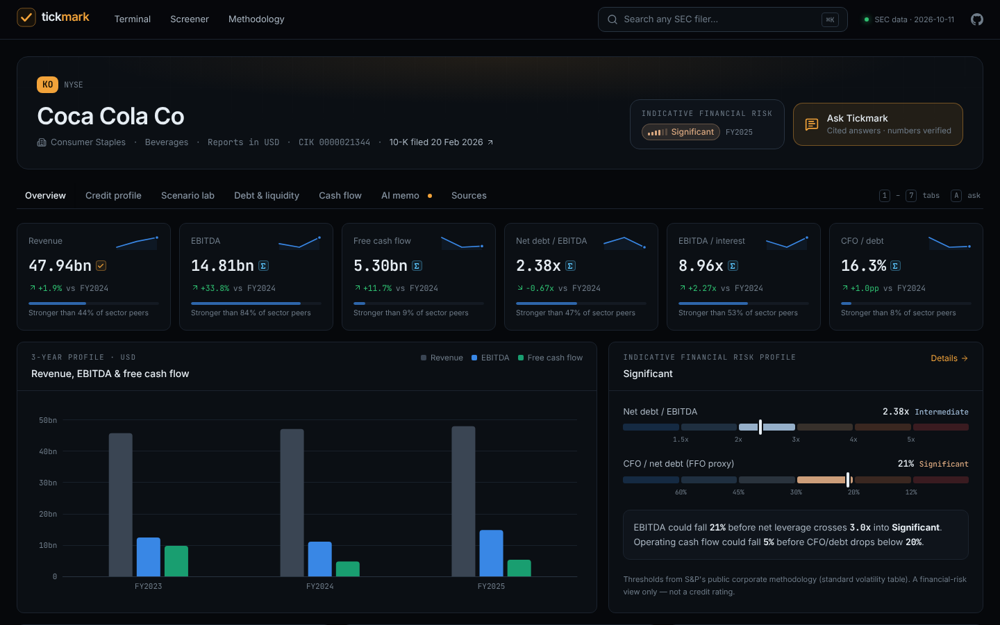
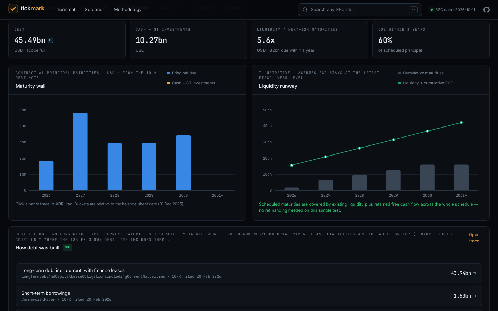
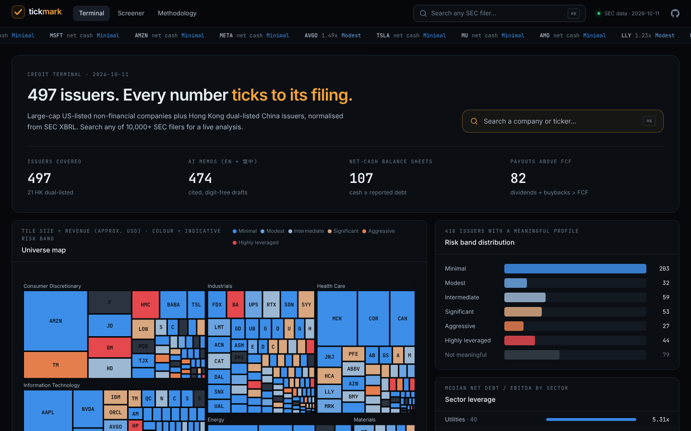
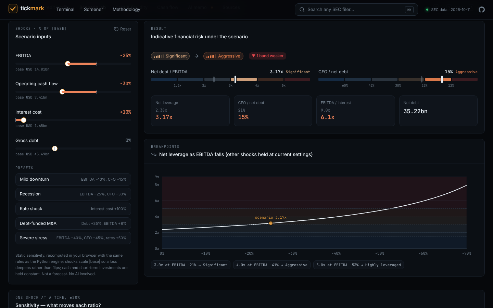
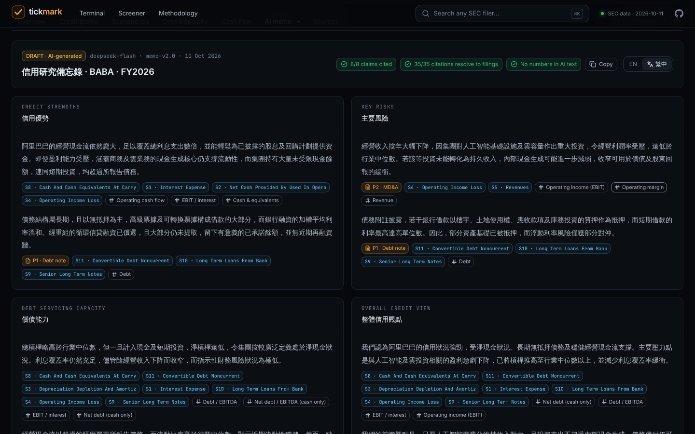
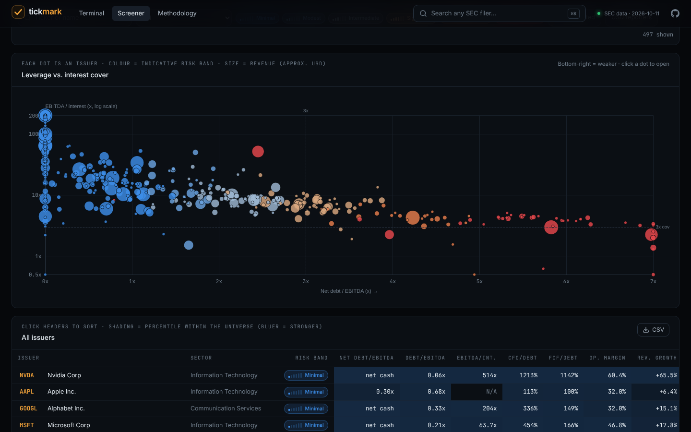
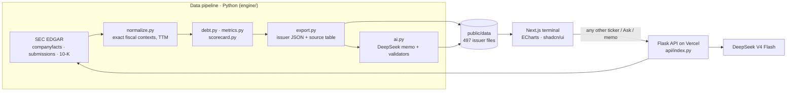

<div align="center">


# Tickmark

**The AI credit analyst that shows its work.**

Corporate credit research generated from SEC filings — leverage, rating-threshold headroom,
debt maturity walls and a cited AI memo — where **every figure ticks back to its source filing**.

[Live demo](https://tickmark-gules.vercel.app) · [Methodology](https://tickmark-gules.vercel.app/methodology)


</div>

---

## Why

Large language models can read a 10-K, but a bank cannot use a model that invents or misquotes numbers.
Tickmark is built on one rule borrowed from audit — a number is only shown if it can be **agreed to its source**
(the auditor's *tick mark*):

| Rule | How it is enforced |
|---|---|
| **Numbers come from code** | A Python engine reads SEC XBRL for exact fiscal contexts, rebuilds debt from tagged components and computes every ratio deterministically. |
| **AI only explains** | DeepSeek writes the memo from computed metrics + real filing excerpts. Its prose may not contain a single digit (validation rejects it), so figures only live in audited tables. In Q&A, every number in an answer is parsed and matched against the dataset. |
| **Missing means N/A, never zero** | Untagged items are shown as N/A with the reason. Partial debt scopes are labelled. Banks, insurers and REITs are excluded rather than forced through the wrong model. |

## What it does

- **497 pre-computed issuers** — large-cap US-listed non-financials plus China issuers dual-listed in Hong Kong (Alibaba 9988, JD 9618, Baidu 9888, NetEase 9999 …), each with 3 fiscal years + TTM.
- **Live analysis of any SEC filer** — search 10,000+ tickers; anything outside the universe runs through the same engine on demand.
- **Tick-and-tie on every number** — click a figure to see its formula, inputs, XBRL concept, form, accession and a link to the filing.
- **Indicative financial-risk band + headroom** — net debt/EBITDA and CFO/debt mapped onto S&P's public standard-volatility table, with *"EBITDA could fall 21% before the band weakens"*.
- **Scenario lab** — shock EBITDA, cash flow, interest cost or debt; band transitions, breakpoints and sensitivity tornados recomputed in the browser.
- **Debt & liquidity** — contractual maturity wall vs. cash, liquidity runway, debt build-up by component.
- **Cash-flow lens** — are dividends and buybacks funded by free cash flow?
- **Bilingual AI memo** — four-section credit memo in English and Traditional Chinese, every claim citing filing passages or SEC facts.
- **Ask Tickmark** — grounded Q&A (English / 中文) with per-figure verification badges.
- **Terminal & screener** — universe treemap, risk-band distribution, sector leverage, scatter of leverage vs. interest cover, percentile-shaded table, CSV export, closest sector peers on every issuer page.
- **Built like a terminal** — `⌘K` search across 10,000+ SEC filers, `1`–`7` to switch tabs, `A` to ask; copy a memo as Markdown or download the raw JSON behind any page.

<p align="center">
  
  
</p>
<p align="center">
  
  
</p>
<p align="center">
  
  
</p>

## Architecture



- **engine/** — the financial core (Python 3.11): SEC transport with fair-access throttling, period normalisation with restatement lineage, reported-borrowings debt build-up, ratio library, risk bands/headroom, Altman Z″, memo generation with JSON/citation/digit guards. 66 unit tests on synthetic fixtures.
- **api/index.py** — Flask app deployed as a Vercel Python function: live analysis, memo generation, grounded Q&A with number verification, per-IP rate limits.
- **app/, components/** — Next.js 16 (App Router) + TypeScript + Tailwind, Radix/shadcn primitives, cmdk command palette, Apache ECharts, Framer Motion.
- **.github/workflows** — CI (tests + build) and a weekly SEC data refresh that commits the new dataset.

## Run locally

```bash
# 1. configuration
cp .env.example .env            # set SEC_USER_AGENT (name + email) and DEEPSEEK_API_KEY

# 2. Python engine + API
python3.11 -m venv .venv && .venv/bin/pip install -r engine/requirements.txt pandas
(cd engine && ../.venv/bin/python -m unittest discover -s tests)    # 66 tests
.venv/bin/python api/index.py &                                      # Flask API on :5328

# 3. web app (proxies /api/py/* to Flask in development)
npm install && npm run dev                                           # http://localhost:3000
```

Rebuild the dataset (≈ 15 min for downloads, ≈ 45 min for memos):

```bash
cd engine
../.venv/bin/python -m pipeline.universe   # choose issuers, download submissions
../.venv/bin/python -c "import json; from pipeline import fetch; fetch.bulk([u['cik'] for u in json.load(open('universe.json'))], kinds=('companyfacts',), workers=3)"
../.venv/bin/python -m pipeline.build      # issuer JSON + universe index
../.venv/bin/python -m pipeline.ai         # memos (only new/changed issuers)
../.venv/bin/python -m pipeline.build      # merge memos
```

## Deploy

**Public app:** [tickmark-gules.vercel.app](https://tickmark-gules.vercel.app).
The deployed Python API has been checked with live SEC analysis and new bilingual DeepSeek memo generation for SHAK, plus grounded Q&A for KO.

One Vercel project serves both the Next.js app and the Python API. Step-by-step guide: [docs/DEPLOY.md](docs/DEPLOY.md).
Set `SEC_USER_AGENT` and `DEEPSEEK_API_KEY` as environment variables; never commit `.env`.

## Methodology & limits

Full formulas, band thresholds, AI guardrails and limitations are on the in-app [Methodology page](https://tickmark-gules.vercel.app/methodology).
Key limits: unadjusted EBITDA; separately tagged lease liabilities are not added to debt; issuer-specific XBRL extensions are not read (partial scopes are labelled);
no market data; the risk band is a financial-risk view, **not a credit rating**. Not investment advice.

## Credits

Data: SEC EDGAR (public domain). Built with open-source software — see [THIRD_PARTY.md](THIRD_PARTY.md).
Original code © Sam Yu, MIT licence.

**Author:** Sam Yu — BBA (Accounting & Data Analytics), The University of Hong Kong · samuel_yu@connect.hku.hk
